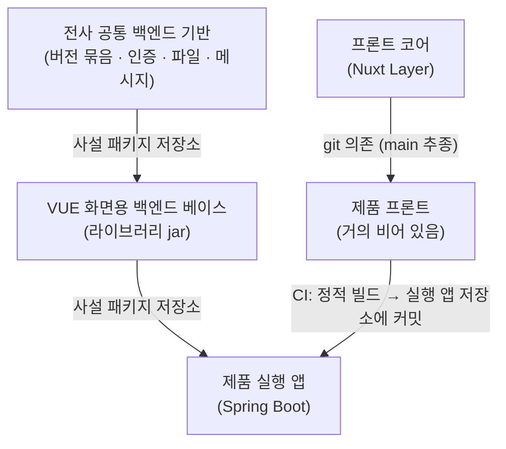

회사 제품을 웹스퀘어(WebSquare — 국산 웹 UI 프레임워크)에 묶인 화면에서 VUE 로 옮기는 차세대 마이그레이션이 시작됐다. 새 화면은 이미 VUE 로 돌고 있는 사내 기반 저장소를 **상속받아 그 위에 얹는** 방식으로 가기로 했다. 그래서 첫 일은 기반 저장소 다섯 개가 각각 무엇을 맡는지 지형을 그리는 것이었다. 세부 구현은 파고들지 않았고, 2026-09-09 의 각 저장소 `main` 을 기준으로 봤다.

## 한눈에 — 백엔드와 프론트가 대칭인 3단 상속



먼저 짚을 점은 **프론트가 자기 서버로 뜨지 않는다**는 것이었다. 제품 프론트 저장소는 정적 파일을 빌드할 뿐이고, 그 산출물은 CI 가 백엔드 실행 앱 저장소의 정적 리소스 폴더에 통째로 커밋한다. 실행체는 백엔드 하나다.

## 각 층이 맡는 것

| 층 | 맡는 것 | 눈여겨본 점 |
|---|---|---|
| 전사 공통 백엔드 | 라이브러리 버전 묶음(BOM — 쓰는 라이브러리 버전을 한곳에 고정하는 명세), 인증 · 파일 · 메시지 · 스트리밍, DB 별 어댑터 | 로그인 · 파일 업로드 같은 기본기는 이미 공통으로 있다 |
| VUE 화면용 백엔드 베이스 | 실행 앱이 아니라 **라이브러리**. 인증 · 계정 · 파일 API 와 자동 설정 | 모든 기능이 controller · converter · mapper · model · service 5단으로 통일돼 있다. 새 기능도 이 규약을 따르면 된다 |
| 제품 실행 앱 | 자바 파일이 사실상 세 개 — 기동 클래스, 보안 설정, 앱 설정 바인딩 | 놀랄 만큼 얇다. 거의 모든 것이 베이스에서 온다 |
| 프론트 코어 | Nuxt Layer(다른 Nuxt 프로젝트를 통째로 베이스로 깔고 일부만 덮어쓰는 기능) 형태의 SPA. 도메인 · 인프라 · 스토어 · 컴포저블 계층 | 우리가 실제로 상속받을 본체 |
| 제품 프론트 | 소스 파일 네 개. 코어 상속 한 줄과 페이지 목록뿐 | 페이지 목록이 아직 빈 배열이었다 |

## 코어를 갈아끼우는 방법 두 가지

상속받은 것을 바꾸는 방법이 백엔드와 프론트에 하나씩 실제로 쓰이고 있었다.

**백엔드 — 같은 이름의 빈으로 덮기.** 실행 앱의 보안 설정은 베이스가 자동 설정으로 등록하는 빈과 **이름이 같다**. 베이스 쪽에 "없을 때만 등록" 조건이 없으니, 원래라면 이름 충돌로 기동이 깨진다. 실행 앱 설정에 아래가 켜져 있어서 덮어쓰기가 성립한다.

```yaml
spring:
  main:
    allow-bean-definition-overriding: true   # 이게 있어야 같은 이름 재정의가 된다
```

우리 쪽에서 같은 수법을 쓰려면 이 설정을 함께 가져가야 한다.

**프론트 — 레이어 상속 + 경로 치환.** 코어를 통째로 상속한 뒤, 코어가 참조하는 파일 경로 몇 개만 Vite alias 로 제품 쪽 파일로 바꿔 끼운다. 전체는 상속, 부분은 치환하는 두 겹이다.

## 코어가 바뀌면 제품도 다시 빌드된다

제품 프론트의 배포 워크플로가 이 구조를 잇는다.

- 트리거는 셋 — 제품 프론트 병합, **코어 병합 시 코어 쪽이 보내는 이벤트**, 수동 실행. 제품 코드가 그대로여도 코어가 바뀌면 다시 빌드해야 하기 때문이다.
- 의존성 잠금 파일(lockfile)을 **일부러 두지 않는다.** 매 빌드가 코어 `main` 최신을 강제로 받는다.
- 대신 빌드할 때 설치된 코어의 커밋을 기록해 두고, 산출물과 함께 소스 커밋 · 코어 커밋 · 트리거 · 시각을 매니페스트 파일로 남긴다. 문제가 생기면 어느 커밋에서 나온 화면인지 거슬러 올라갈 수 있다.

잠금 파일을 두지 않는 대가를 매니페스트로 갚는 구조다. 재현성 대신 "항상 최신"을 골랐고, 무엇이 들어갔는지는 사후에 추적한다.

## 우리가 얹을 때

- 프론트 — 새 저장소에서 코어를 상속하고, 화면은 자기 폴더에 더하고, 코어 파일을 바꿔야 하면 alias 로 치환한다. 코어 자체를 고쳐야 하면 코어에 PR 을 넣고, 병합되면 이벤트로 제품이 다시 빌드된다.
- 백엔드 — 베이스를 의존하면 자동 설정과 인증 · 계정 · 파일 API 가 따라온다. 바꿀 설정은 같은 이름 빈으로 덮고, 도메인 기능은 5단 규약으로 더한다.

## 남은 확인거리

- 실행 앱이 물고 있는 베이스 버전이 각 베이스의 `main` 보다 뒤처져 있었다. 버전 동기화는 다른 브랜치에서 한다는 주석이 있어, 그 브랜치 기준으로는 다를 수 있다 — 확인 필요.
- 같은 패턴의 저장소 쌍이 다른 제품(대시보드)에도 있다. 베이스가 여러 소비자를 전제로 설계됐다는 뜻으로 읽었다.
- **웹스퀘어 화면을 어떤 규칙으로 VUE 화면에 대응시킬지**는 다섯 저장소 어디에도 없다. 별도 과제다.
- 프론트 쪽 두 저장소 모두 README 가 비어 있어 온보딩 문서가 없다.

## 돌아보면

- 상속 구조를 파악할 때는 **무엇을 덮을 수 있고, 어떻게 덮나**를 먼저 찾는 게 빨랐다. 백엔드는 같은 이름 빈 + 덮어쓰기 허용 플래그, 프론트는 레이어 + alias. 이 두 가지를 알면 나머지는 "베이스를 따른다"로 정리된다.
- "실행 앱이 얇다", "제품 프론트가 비어 있다"는 결함이 아니라 설계였다. 비어 있는 저장소일수록 무엇이 어디서 오는지를 먼저 그려야 한다.
