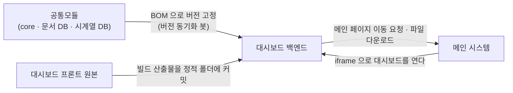

고객사 문서관리 모니터링에 **현장 선택 기능과 대시보드 위젯을 더하는** 마일스톤을 시작하기 전에, 대시보드 백엔드가 사내 공통모듈에 얼마나, 어떤 경로로 기대고 있는지 먼저 따라가 봤다. 결론은 한 줄이다. **대시보드 코드는 업무 쿼리만 갖고 있고, 서버가 서버로 동작하는 데 필요한 나머지(DB 연결 · 보안 · 응답 포맷 · 예외 처리 · 파일)는 전부 공통모듈이 Spring Boot 자동 설정으로 끼워 넣는다.** 그 덕에 이번 작업은 위젯 한 벌만 만들면 됐지만, 그 과정에서 자동 설정이 숨기는 함정도 몇 개 봤다.

## 용어 몇 개

- **자동 설정(AutoConfiguration)** — 의존성 jar 안에 등록된 설정 클래스를 Spring Boot 가 알아서 읽어 들이는 기능. 앱에서 따로 가져오지 않아도 붙는다.
- **`@ConditionalOnMissingBean`** — "같은 빈이 아직 없을 때만 만든다"는 조건. 공통모듈이 기본값을 깔고, 앱이 같은 빈을 정의하면 앱 쪽이 이긴다.
- **BOM** — 쓰는 라이브러리 버전을 한곳에 고정하는 명세.

## 저장소 지도

- 대시보드 저장소는 다른 제품의 템플릿에서 갈라져 나와 **실행 식별자가 옛 이름 그대로** 남아 있었다. 로그나 설정에서 그 이름을 보면 다른 서버로 착각하기 쉽다.
- 프론트 원본은 별도 저장소에 있고, 병합되면 빌드 결과가 대시보드 저장소의 정적 폴더로 커밋된다. 어느 커밋에서 왔는지는 매니페스트 파일에 남는다.
- 대시보드 백엔드를 배포하는 파이프라인은 저장소 안에 없었다 — 확인 필요로 남겼다.

## 공통모듈이 끼워 넣는 것

공통모듈 jar 세 개가 자동 설정 20여 개를 올린다. 대시보드 동작을 이해하는 데 꼭 알아야 했던 것은 셋이다.

1. **회사 패키지 전체를 컴포넌트 스캔한다.** 대시보드 앱은 자기 패키지만 스캔하도록 적었는데도 공통모듈의 빈과 컨트롤러가 전부 올라오는 이유가 이것이다.
2. **DB 설정을 조건 없이 올린다.** 그래서 대시보드가 쓰지 않는 보조 DB 의 커넥션 풀까지 생긴다.
3. **보안 필터 체인을 "없을 때만" 조건으로 정의한다.** 앱이 같은 이름으로 정의하면 앱 것이 채택된다.

앱 설정은 Spring Boot 기본 DB 자동 설정을 꺼 두고 있었다. 연결은 전적으로 공통모듈이 맡는다.

## 기동할 때 알아둘 점

- **설정은 두 군데서 온다.** 앱의 프로파일별 설정 파일에 더해, 공통모듈 jar 안에 든 설정 파일을 공통모듈이 직접 읽는다. 공용 설정은 전부 jar 쪽에 있어서 앱 저장소만 봐서는 안 보인다.
- **프로파일 함정.** 공통모듈은 활성 프로파일을 **시스템 프로퍼티**로 읽어 설정 파일을 고른다. 테스트에서 어노테이션으로만 프로파일을 지정하면 활성 프로파일과 실제로 읽는 설정 파일이 어긋난다. 빌드 스크립트 주석에 실측 기록이 있었다.
- **매퍼는 표식 어노테이션이 붙어야 등록된다.** 매퍼 스캔 조건에 어노테이션이 걸려 있어서, 붙이지 않으면 조용히 빠진다.

## 요청이 위젯 데이터가 되기까지

메인 시스템이 대시보드를 iframe 으로 열고, 그 안의 VUE 앱이 REST 를 호출하면 공통모듈의 인증 필터가 요청을 검사한다. 모든 컨트롤러는 공통 응답 래퍼로 결과를 감싸고, 예외는 공통 예외 처리기가 화면 요청이면 에러 페이지로, REST 요청이면 JSON 으로 돌려준다.

인증 흐름을 따라가며 배운 것은, **인증에 관여하는 단계가 서로 다른 저장소에 흩어져 있다**는 점이다. 한 저장소만 열어서는 인증이 어떻게 이어지는지 보이지 않았다.

## 같은 이름의 보안 체인이 네 군데에 있다

REST 와 화면용 보안 필터 체인이 공통모듈 core, 두 DB 어댑터 모듈, 그리고 대시보드 앱에 **같은 이름으로** 정의돼 있었다. 앱 설정이 자동 설정보다 먼저 등록되고 나머지는 "없을 때만" 조건이라 대시보드 것이 채택된다.

문제는 대시보드의 체인이 어댑터 모듈의 정의를 **거의 그대로 복사**한 뒤 대시보드 경로만 더한 형태라는 점이다. 공통모듈 쪽 체인이 바뀌어도 복사본은 따라 바뀌지 않는다. 덮어쓰기 구조의 대가다.

## 대시보드가 실제로 쓰는 것

Java 파일 160여 개 중 절반 이상이 공통모듈을 가져다 쓴다. 대부분은 응답 래퍼 · 트랜잭션 · 매퍼 표식 세 가지이고, 나머지는 파일 · 스트리밍 · 시계열 DB · 외부 API 호출용 클라이언트를 몇 군데서 쓴다. 데이터는 세 곳에서 온다 — 관계형 DB(위젯 조회 전부), 문서 DB(사용자별 페이지 · 위젯 배치 · 테마), 시계열 DB(날씨 · 센서).

## 그래서 이번 마일스톤에서는

- **공통모듈은 건드릴 일이 거의 없다.** 위젯 하나는 Controller → Service → Mapper → SQL XML → 응답 DTO 한 벌이고, 스캔 · 트랜잭션 · 응답 포맷 · 예외는 자동으로 붙는다.
- **선택한 현장은 스키마 변경 없이 저장된다.** 사용자별 페이지 데이터가 백엔드가 구조를 모르는 JSON 이라, 위젯 설정에 선택 현장을 넣고 기존 저장 API 로 보내면 된다.
- **현장 범위는 서버에서 세션 사용자 기준으로 제한한다.** 프론트가 보낸 현장 목록을 믿지 않고, 새 쿼리마다 세션 사용자가 볼 수 있는 현장과 조인한다. 기존 모니터링 SQL 에 같은 패턴이 있었다.
- **문서관리 데이터는 대시보드 SQL 이 직접 읽고 있었다.** 다른 서비스의 API 를 거칠 필요가 없었다.

## 아직 모르던 것

공통모듈 일부 설정 클래스는 소스 jar 에 빠져 있어 바이트코드로만 확인했다. 인증 설정 일부, 프론트의 현장 선택 구조, 메인 시스템 쪽 연동부, 대시보드 배포 경로도 각각 다른 저장소나 설정을 봐야 풀린다. 이것들은 확인 필요로 남겼다.

## 돌아보면

- 자동 설정 기반 앱은 **앱 코드에 "무엇이 붙는지"가 한 줄도 없다.** 그 목록은 의존 jar 의 자동 설정에 있다.
- "없을 때만" 조건 + 같은 이름 덮어쓰기는 편하지만, 덮어쓴 쪽이 **복사본**이면 원본 변경을 놓친다.
- 전체 패키지 스캔과 조건 없는 설정은 "안 쓰는 것도 올라온다"는 뜻이다. 쓰지 않는 DB 풀이 생기는 것처럼, 의존성만으로 런타임 자원이 늘어난다.
