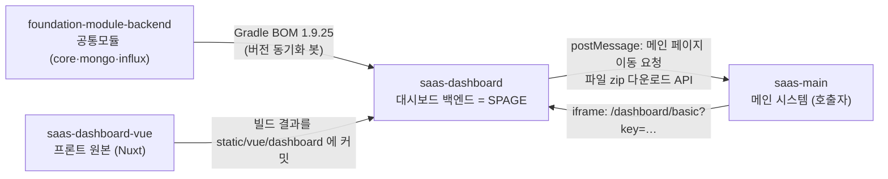
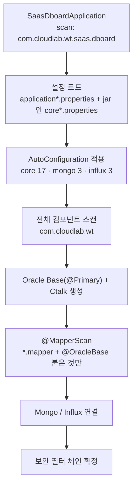
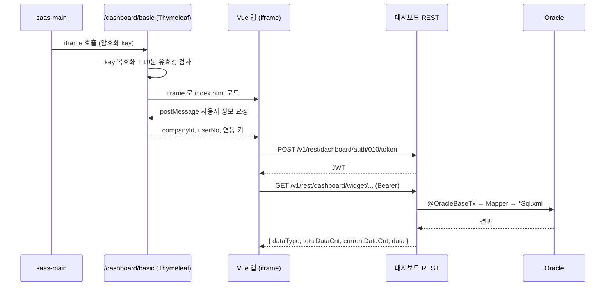

(주)금도건설 문서관리 모니터링에 **현장 선택 기능과 대시보드 위젯을 추가하는 마일스톤**을 시작하기 전에, 대시보드 백엔드(`saas-dashboard`)가 사내 공통모듈(`foundation-module-backend`)에 얼마나, 어떤 경로로 기대고 있는지 정리한 글이다. 한 줄로 요약하면 이렇다. **대시보드 코드는 "업무 쿼리"만 갖고 있고, 서버가 서버로 동작하는 데 필요한 나머지(DB 연결, 보안, 응답 포맷, 예외 처리, 파일·S3)는 전부 공통모듈이 Spring Boot 자동설정으로 끼워 넣는다.**

기준: `saas-dashboard` main `9fb6667`, 공통모듈 `1.9.25`, 2026-09-30 스냅샷.

## 먼저 알아둘 용어

- **AutoConfiguration(자동설정)**: jar 안의 `META-INF/spring/…AutoConfiguration.imports` 파일에 적힌 설정 클래스를, 의존성만 추가하면 Spring Boot가 알아서 읽어 들이는 기능. 앱 코드에서 따로 `@Import`하지 않아도 된다.
- **`@ConditionalOnMissingBean`**: "같은 빈이 아직 없을 때만 만든다"는 조건. 공통모듈이 기본값을 깔아 두고, 앱이 같은 이름으로 정의하면 앱 쪽이 이기게 만드는 장치다.
- **`@MapperScan`**: MyBatis 매퍼 인터페이스를 찾아서 SQL XML과 연결해 주는 설정.
- **JWT**: 서버가 서명해서 발급하는 토큰. REST 호출 때 `Authorization: Bearer …` 헤더로 보낸다.
- **jasypt**: 설정 파일 값을 `ENC(…)` 형태로 암호화해 두고 기동할 때 복호화하는 라이브러리.

## 1. 이름부터 헷갈린다: 이 저장소는 "SPAGE"로 뜬다

대시보드는 Server-Page 템플릿에서 갈라져 나와서 실행 식별자가 그대로 남아 있다. 로그나 호스트를 볼 때 `saas-page` 저장소와 혼동하기 쉽다.

| 항목 | saas-dashboard (이 저장소) | saas-page (별도 저장소) |
|---|---|---|
| `core.server-code` | `saas-spage` | `saas-page` |
| 포트 | 10090 | 10130 |
| 애플리케이션 이름 | `SAAS-SPAGE` | — |
| 잔존 클래스명 | `SaasSpageScheduler` 등 | — |

즉 **"spage" 호스트 = 대시보드 서버**다. 공통모듈 설정의 `core.hosts.saas-spage`나 PDF 변환 콜백 주소도 이 서버를 가리킨다.

## 2. 누가 누구를 참조하나: 저장소 지도

- **foundation-module-backend**: `build.gradle`에서 BOM으로 버전을 고정한다. `github-actions` 봇이 "foundation-module-backend 기준 버전 동기화 [skip ci]" 커밋으로 버전을 올려 준다.
- **saas-dashboard-vue**: 프론트 원본은 이 저장소에 없다. Vue 쪽 PR이 머지되면 빌드 산출물이 `src/main/resources/static/vue/dashboard/`에 "deploy: saas-dashboard [skip ci]" 커밋으로 들어온다. 어떤 커밋에서 왔는지는 `.deploy-manifest.json`에 적힌다.
- **saas-main**: 사용자가 대시보드를 여는 출발점이다. 대시보드를 iframe으로 띄운다.
- 워크스페이스의 나머지(`saas-page`, `saas-mobile`, `saas-api`, `saas-report`, `saas-hp`)는 대시보드와 코드로 엮여 있지 않다. 같은 공통모듈을 쓰는 형제일 뿐이다(`saas-api`는 1.7.21, `saas-hp`는 구세대 core).
- 대시보드 백엔드 자체를 빌드·배포하는 파이프라인은 저장소 안에 없다(`.github` 없음). **확인 필요**.

## 3. 공통모듈에는 무엇이 들어 있나

jar 세 개가 자동설정 23개를 올린다.

| jar | 핵심 내용 |
|---|---|
| `-core` | DB(Oracle) 연결, 보안(JWT 필터·필터 체인), 응답 래퍼, 전역 예외 처리, 파일·S3·Lambda, WebClient, Thymeleaf, Swagger, 암호화 유틸 |
| `-mongo` | TLS로 MongoDB 연결, `MongoTemplate`, 리포지토리 스캔 |
| `-influx` | InfluxDB 클라이언트, `InfluxDbTemplate` |

그중 대시보드 동작을 이해하는 데 꼭 알아야 할 것은 세 개다.

1. **`CoreComponentScanConfig`**: `com.cloudlab.wt` 패키지 전체를 컴포넌트 스캔한다. 대시보드 앱은 `com.cloudlab.wt.saas.dboard`만 스캔하는데도 core의 빈과 컨트롤러가 전부 올라오는 이유가 이것이다.
2. **`CoreOracleDbConfig`**: `@Import`로 `OracleBaseConfig`(주 DB, `@Primary`)와 `OracleCtalkConfig`를 **조건 없이** 올린다. 그래서 대시보드는 Ctalk DB를 쓰지 않는데도 커넥션 풀(2개)이 생긴다.
3. **`CoreSecurityConfig`**: 보안 필터 체인 세 개를 `@ConditionalOnMissingBean`으로 정의한다(아래 §6).

앱의 `application.yml`은 Spring Boot 기본 `DataSource`·`Mongo`·`Influx` 자동설정을 **exclude** 한다. 연결은 전적으로 공통모듈이 맡는다.

## 4. 서버가 뜰 때: 기동 체인

단계마다 알아둘 점:

- **설정은 두 군데서 온다.** 앱의 `application-{profile}.properties`에 더해, 공통모듈 jar 안의 `core.properties`와 `core-{profile}.properties`를 core가 `@PropertySource`로 읽는다. DB 접속 정보, 형제 서비스 호스트(`core.hosts.*`), S3 경로 같은 공용 설정은 전부 jar 쪽에 있다.
- **프로파일 함정.** core는 `spring.profiles.active` **시스템 프로퍼티**로 파일을 고른다. 테스트에서 `@ActiveProfiles("dev")`만 붙이면 활성 프로파일은 dev인데 읽는 설정은 `core-local.properties`가 된다. `build.gradle` test 태스크 주석에 실측 기록이 있다.
- **매퍼는 `@OracleBase`가 붙어야 붙는다.** 스캔 조건이 `basePackages = "com.cloudlab.wt.**.mapper"`, `annotationClass = @OracleBase`이다. XML은 `classpath*:/mapper/oracle/base/**/*Sql.xml` 패턴으로 찾는다. 타입 별칭 패키지가 `com.cloudlab.wt.**.model`이라서 XML에 `resultType="ModaDashboardUserGetUserResDto"`처럼 클래스 이름만 써도 된다.
- **Mongo 리포지토리도 공통모듈이 찾아 준다.** `@EnableMongoRepositories("com.cloudlab.wt")` 덕분에 대시보드의 `Mongo*Repository` 3종이 자동으로 등록된다.

## 5. 사용자가 위젯 데이터를 받기까지: 요청 체인

- **진입**: saas-main이 `{운영자여부}_{회사ID}_{사용자번호}_{타임스탬프}`를 암호화한 key로 `/dashboard/basic`을 연다. 컨트롤러(`ModpDashboardBasicController`)는 core의 `CoreCipherUtils`로 복호화하고 `CoreTimestampUtils`로 10분 안에 만든 key인지 확인한다.
- **셸과 Vue의 대화**: Thymeleaf 페이지는 iframe 하나로 Vue 앱을 띄운다. 둘은 같은 origin의 `postMessage`로 사용자 정보, 새 창 열기, 메인 페이지 이동 요청을 주고받는다.
- **토큰 발급**: `/auth/010/token`은 core의 `CoreBmAuthApiUserJwtService.createJwt()`를 그대로 호출한다. 토큰 유효기간은 24시간이다.
- **인증**: 이후 REST 호출은 core의 `SecurityJwtAuthenticationFilter`가 검사한다. 토큰이 없으면 `AUTH_TOKEN_NOT_FOUND`, 잘못되면 `INVALID_AUTH_TOKEN`(401)이 나간다.
- **응답 포맷**: 모든 컨트롤러가 `coreRestResponseWrapper.wrap(dto)`로 감싼다. 리스트면 `dataType: "list"`와 건수가, 단건이면 `"map"`, 비어 있으면 `"null"`이 들어간다.
- **예외**: `CoreExceptionControllerAdvice`가 받아서, HTML 요청이면 core 에러 페이지를, REST 요청이면 JSON 에러 모델을 돌려준다. `@CoreRestResponseSets`는 이 에러 코드들을 Swagger 문서에 붙여 주는 역할만 한다.

## 6. 보안 필터 체인: 같은 이름이 네 군데서 정의된다

| 순서 | 빈 이름 | 어디서 정의 | 누가 채택 | 하는 일 |
|---|---|---|---|---|
| 10 | `securityFilterRestNoAuthChain` | core | core | 인증 제외로 지정한 REST URL을 통과시킨다 |
| 20 | `securityFilterRestChain` | core, mongo, influx, **대시보드** | 대시보드 | `/v*/rest/**` 등 REST 전체. 무상태, JWT 필터 적용 |
| 30 | `securityFilterViewChain` | core, mongo, influx, **대시보드** | 대시보드 | 화면 요청. `/dashboard/**`, `/safety/**` 등은 permitAll |

앱의 `@Configuration`이 자동설정보다 먼저 등록되고, 나머지 정의는 전부 `@ConditionalOnMissingBean`이라서 대시보드 것이 채택된다. 대시보드의 `SecurityConfig`는 mongo 모듈 정의를 거의 그대로 복사해 View 체인에 대시보드 경로만 추가한 형태다. **공통모듈 쪽 체인이 바뀌면 이 복사본을 손으로 맞춰야 한다.**

`/foundation/**` 아래 core 기능 API(첨부파일, 사용자·근로자 사진, SMS, 테스트 등)도 전체 스캔 때문에 대시보드 서버에 같이 등록된다. 다만 REST는 CLOUDLAB 권한에서만 열린다.

## 7. 대시보드가 실제로 쓰는 core 기능

158개 Java 파일 중 95개가 공통모듈을 import 한다. 많이 쓰는 순서대로 정리했다.

| 무엇 | 파일 수 | 어디에 |
|---|---|---|
| `CoreRestResponseWrapper` · `@CoreRestResponseSets` | 32 | 모든 컨트롤러 |
| `@OracleBaseTx` | 30 | 서비스 트랜잭션 |
| `@OracleBase` | 24 | 매퍼 인터페이스 |
| `CoreException` · `CoreExceptionBaseCode` | 8 | CCTV·드론·캡처, 화면 진입 |
| `CoreBmFileAttachedService` 등 파일 서비스 | 5~7 | 첨부파일 공통, 추가위험·안전운영·영상캡처 위젯 |
| `CoreVariables` | 5 | 메인 호스트, 운영 회사ID(공지), 프로파일(작성주기 모니터링), S3 경로(캡처) |
| `InfluxDbTemplate` | 3 | 날씨 스케줄러·위젯, 기울기 센서 위젯 |
| `CoreBmStreamingService` | 1 | CCTV 스트리밍 URL |
| `webClientLongReadTime` (core 빈) | 1 | 기상청 단기예보 API 호출 |

저장소별로 보면 이렇다.

- **Oracle Base**: 위젯·사용자·회사 조회 전부(매퍼 XML 22개)
- **MongoDB**: `dashboard_pages`(사용자별 페이지와 위젯 배치), `dashboard_theme`, `dashboard_sharing_company_widget_sets`
- **InfluxDB**: 날씨 예보(3시간 간격 스케줄러), `tilt_sensor`
- **S3**: 첨부 업로드·썸네일, 영상캡처 실패 시 보상 삭제

## 8. 그래서 이번 마일스톤에서는

- **공통모듈은 건드릴 일이 거의 없다.** 위젯 하나는 Controller → Service → Mapper(`@OracleBase` 필수) → `*Sql.xml` → ResDto 한 벌이다. 스캔, 트랜잭션, 응답 포맷, 예외는 자동으로 붙는다.
- **선택한 현장은 스키마 변경 없이 저장된다.** `dashboard_pages`의 `data`는 백엔드가 구조를 모르는 JSON이라서, 위젯 설정에 선택 현장을 넣고 기존 `/pages/020/datas`로 저장하면 된다.
- **현장 범위는 서버에서 세션 사용자 기준으로 제한한다.** 새 쿼리는 `sessionUserNo`로 `TCC_USER_PROJ_CODE`(자기 현장) 또는 `TCCMS_MON_USER_PROJ`(모니터링 현장)와 조인해야 한다. 기존 작성주기 모니터링 SQL의 `Exists … TCC_USER_PROJ_CODE` 패턴이 참고 대상이다.
- **문서관리 데이터는 이미 대시보드 SQL에서 직접 읽고 있다.** 작성주기 모니터링 SQL이 `TDCMT_DCMT`, `TDCMT_CTGRP`, `TMONT_CYC_ITEM_CODE_PROJ`를 조회하므로 `saas-api`의 DCMT API를 거칠 필요가 없다.

## 아직 모르는 것

| 항목 | 이유 | 풀려면 |
|---|---|---|
| core `config`·`aop`·`listener`·예외 컨트롤러 내부 로직 | sources jar에 빠져 있어서 바이트코드(`javap`)로만 확인 | `foundation-module-backend` clone |
| 인증 제외 URL의 실제 목록 | 설정이 암호화되어 있음. 토큰 발급 API가 여기 포함된 것은 추정 | 공통모듈 원본 또는 담당자 확인 |
| Vue 쪽 현장 선택·위젯 등록 구조 | 번들에서 컴포넌트명·API 경로만 뽑음 | `saas-dashboard-vue` clone |
| key 생성 규칙, iframe 호출부 | 대시보드 쪽 복호화 로직으로 역추정 | `saas-main` clone |
| 대시보드 백엔드 배포 경로 | 저장소에 `.github` 없음 | 공용 워크플로·인프라 저장소 |

## 직접 따라가 보기

- 공통모듈 소스: `~/.gradle/caches/modules-2/files-2.1/com.cloudlab.wt/foundation-module-backend-core/1.9.25/*/…-sources.jar`
- 소스에 없는 설정 클래스: 바이너리 jar를 풀고 `javap -p -v com/cloudlab/wt/core/config/CoreOracleDbConfig.class`
- 대시보드 진입: `modp/dashboard/controller/ModpDashboardBasicController.java` → `templates/modp/dashboard/ModpDashboardBasic.html`
- 보안 체인: `config/SecurityConfig.java`와 mongo jar의 `MongoSecurityConfig.java` 비교
